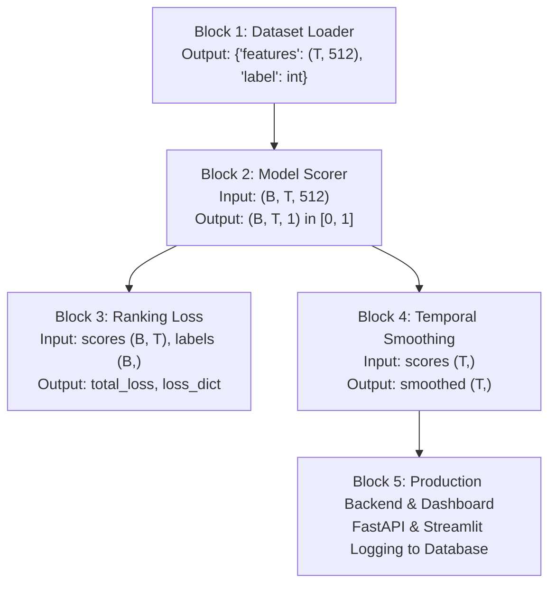

# 🧩 Modular Blocks & Plug-and-Play Customization Guide

This guide explains the **Input/Output contract** for each modular block in the codebase and demonstrates how to **swap or replace any component** (model, loss function, dataset, smoothing algorithm, or database) without breaking the rest of the system.

---

## 🏗️ Architecture Flow & Interface Contracts

Every block in the pipeline adheres to a strict interface contract:



---

## 🔄 1. How to Replace the Neural Network Model
**File to modify**: [`src/models/mil_model.py`](file:///c:/Users/SAI%20VENKAT%20TEJA%20S/Desktop/Capstone/src/models/mil_model.py#L16)

### Contract:
- **Input**: Tensor `x` of shape `(Batch_Size, Num_Snippets, Feature_Dim)` (e.g. `(B, 10, 512)`).
- **Output**: Tensor of shape `(Batch_Size, Num_Snippets, 1)` with anomaly probability scores in range `[0.0, 1.0]`.

### Example: Replacing the MLP with a Temporal Transformer
In `src/models/mil_model.py`, swap `TemporalScoringNetwork` with:

```python
import torch
import torch.nn as nn

class TemporalTransformerScorer(nn.Module):
    def __init__(self, input_dim: int = 512, nhead: int = 8, num_layers: int = 2, dropout: float = 0.2):
        super().__init__()
        encoder_layer = nn.TransformerEncoderLayer(
            d_model=input_dim,
            nhead=nhead,
            dim_feedforward=input_dim * 2,
            dropout=dropout,
            batch_first=True
        )
        self.transformer = nn.TransformerEncoder(encoder_layer, num_layers=num_layers)
        self.fc = nn.Linear(input_dim, 1)
        self.sigmoid = nn.Sigmoid()

    def forward(self, x: torch.Tensor) -> torch.Tensor:
        # x: (B, T, 512)
        if x.ndim == 2:
            x = x.unsqueeze(0)
        feat = self.transformer(x)    # (B, T, 512)
        scores = self.fc(feat)        # (B, T, 1)
        return self.sigmoid(scores)   # Probabilities in [0, 1]
```

> **What else changes?** Zero! `train.py`, `dashboard.py`, `api.py`, and `evaluate.py` will automatically run with your new Transformer.

---

## 🔄 2. Modular Loss Functions & Pluggable Architecture
**File containing losses**: [`src/models/losses.py`](file:///c:/Users/SAI%20VENKAT%20TEJA%20S/Desktop/Capstone/src/models/losses.py)

### Contract:
- **Input**: `scores` of shape `(Batch_Size, Num_Snippets)` and `labels` of shape `(Batch_Size,)` (0=normal, 1=anomalous).
- **Output**: `(total_loss, loss_dict)` where `total_loss` is a scalar PyTorch tensor and `loss_dict` is a `dict[str, float]` for logging.

### Built-in Formulations Ready to Use:
1. **`TopKRankingLoss`** (`--loss topk`): Baseline Top-K snippet maximization with normal snippet suppression.
2. **`MaxMarginRankingLoss`** (`--loss margin`): Sultani et al. (CVPR 2018) hinge ranking margin with temporal sparsity penalty.
3. **`FocalTopKMILLoss`** (`--loss focal`): Dynamic hard-negative / hard-positive modulating factors $(1 - p)^\gamma$.
4. **`SoftmaxAttentionMILLoss`** (`--loss attention`): Fully differentiable temperature-scaled attention distribution across snippets.
5. **`GEMPoolingLoss`** (`--loss gem`): Generalized Mean ($p$-norm) pooling binary cross-entropy.

### How to Train Any Loss:
```bash
# Train with Max-Margin Ranking Loss
python train.py --loss margin --margin 1.0 --epochs 30

# Train with Focal Top-K Loss
python train.py --loss focal --focal_gamma 2.0 --epochs 30

# Run Automated 5-Loss Benchmark Comparison
python compare_losses.py --epochs 15 --batch_size 32
```

---

## 🔄 3. How to Replace the Dataset
**File to modify**: [`configs/config.yaml`](file:///c:/Users/SAI%20VENKAT%20TEJA%20S/Desktop/Capstone/configs/config.yaml)

### Contract:
- The CSV file must have lines formatted as: `path/to/feature.npy <label>` where `<label>` is `1` for anomalous or `0` for normal.
- Each `.npy` file contains a 512-D CLIP visual embedding.

### Example: Switching to UCF-Crime or Custom CCTV Data
1. Generate your feature CSV files: `data/ucf_train.csv` and `data/ucf_test.csv`.
2. Update [`config.yaml`](file:///c:/Users/SAI%20VENKAT%20TEJA%20S/Desktop/Capstone/config.yaml):
```yaml
data:
  train_csv: "data/ucf_train.csv"
  test_csv: "data/ucf_test.csv"
```
3. Run training:
```bash
python train.py --config configs/config.yaml
```

---

## 🔄 4. How to Replace the Temporal Smoothing Filter
**File to modify**: [`src/models/smoothing.py`](file:///c:/Users/SAI%20VENKAT%20TEJA%20S/Desktop/Capstone/src/models/smoothing.py#L11)

### Contract:
- **Input**: `scores` (1D numpy array of shape `(T,)` or 2D `(B, T)`).
- **Output**: Smoothed numpy array of identical shape.

### Example: Adding Exponential Moving Average (EMA) or Median Filter
In `src/models/smoothing.py`, update `apply_temporal_smoothing`:

```python
from scipy.signal import medfilt

def apply_temporal_smoothing(scores: np.ndarray, sigma: float = 1.0, filter_type: str = "median") -> np.ndarray:
    if filter_type == "median":
        kernel_size = max(3, int(2 * sigma + 1) | 1) # Must be odd
        if scores.ndim == 1:
            return medfilt(scores, kernel_size=kernel_size)
        return np.stack([medfilt(s, kernel_size=kernel_size) for s in scores])
    elif filter_type == "gaussian":
        from scipy.ndimage import gaussian_filter1d
        return gaussian_filter1d(scores, sigma=sigma)
    return scores
```

---

## 🔄 5. How to Replace the Database Storage
**File to modify**: [`src/api/database.py`](file:///c:/Users/SAI%20VENKAT%20TEJA%20S/Desktop/Capstone/src/api/database.py)

### Contract:
Implement the 4 standard methods in `IncidentDatabase`:
1. `log_video(filename, num_snippets, is_anomalous, max_score) -> int`
2. `log_anomalies(video_filename, anomaly_scores, threshold)`
3. `get_recent_incidents(limit) -> pd.DataFrame`
4. `get_statistics() -> dict`

### Example: Switching from SQLite to PostgreSQL
Change `_get_connection()` to use `psycopg2` or `SQLAlchemy` instead of `sqlite3.connect()`. Both FastAPI (`api.py`) and Streamlit (`dashboard.py`) will automatically use the new PostgreSQL backend.

---

## 📊 Summary of Block Swapping

| Building Block | Source File | Contract / Signature | Can Swap With |
|---|---|---|---|
| **Model Scorer** | `src/models/mil_model.py` | `(B, T, 512) -> (B, T, 1)` | Transformer, TCN, LSTM, GRU, GCN |
| **Loss Function** | `src/models/mil_model.py` | `(scores, labels) -> (loss, dict)` | Top-K, Max-Margin, BCE, Focal Loss |
| **Smoothing Filter** | `src/models/smoothing.py` | `scores -> smoothed_scores` | Gaussian, EMA, Median, Savitzky-Golay |
| **Dataset Loader** | `src/data/dataset.py` | `idx -> {'features': tensor, 'label': int}` | UCF-Crime, ShanghaiTech, Custom feeds |
| **Audit Database** | `src/api/database.py` | `IncidentDatabase` class | SQLite, PostgreSQL, MongoDB, Redis |
